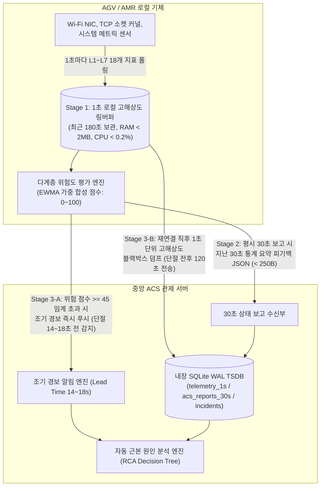
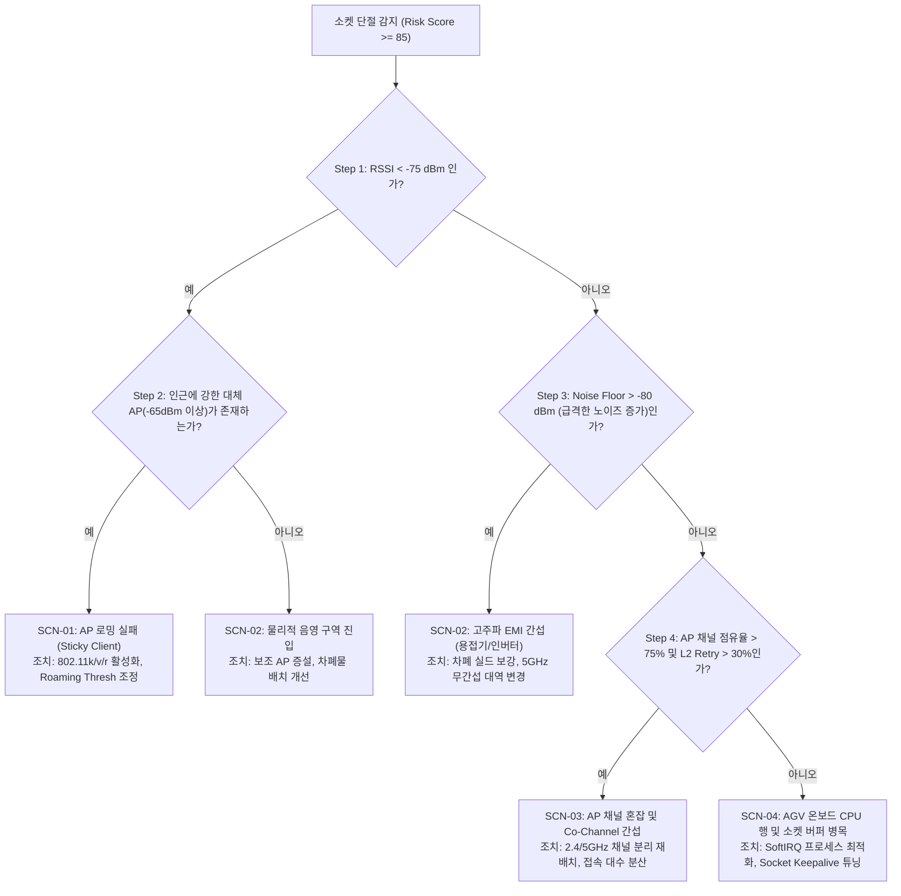

# 스마트 팩토리 AGV/AMR 무선 네트워크 텔레메트리 관제 & 사전 감지 대시보드

[](https://ghcr.io/planner77/network_dashboard)
[](https://python.org)
[](https://fastapi.tiangolo.com)
[](#)

스마트 제조 및 물류 현장에서 운용되는 **AGV(무인반송차) 및 AMR(자율이동로봇)**이 상위 제어 시스템인 **ACS(AGV Control System)**와 통신할 때 발생하는 **무선 단절(Socket Disconnection) 현상을 조기에 사전 감지(Pre-detection)**하고, 단절 발생 시 **다계층 텔레메트리 지표 기반 사후 원인 분석(Post-mortem RCA)**을 수행하는 실시간 시계열 관제 및 인터랙티브 모의 진단 플랫폼입니다.

---

## 1. 프로젝트 배경 및 문제 정의

### 1.1 현장 문제점: 30초 소켓 상태 보고의 물리적 한계
- **통신 구조**: AGV/AMR은 공장 천장에 설치된 Wi-Fi AP 및 공장 유선망을 거쳐 중앙 ACS 서버와 TCP 소켓 세션을 유지하며, **30초 주기로 상태 보고(Heartbeat)**를 전송합니다.
- **단절 현상**: 주행 중 철골 랙 음영지역 진입, AP 로밍 실패(Sticky Client), 용접기/인버터의 전자기파(EMI) 노이즈, AP 채널 포화 등으로 갑작스러운 소켓 단절이 발생하여 AGV가 비상 정지하고 전체 물류 라인이 멈춥니다.
- **사전 감지 불가 (나이퀴스트 샘플링 한계)**:
  무선 전파 감쇠나 TCP 버퍼 적체는 **3~15초 사이**에 급격히 진행되는데, 상위 보고 주기가 **30초**로 너무 길어 단절 직전까지 ACS는 AGV가 정상 상태인 것으로 오판합니다.
- **원인 분석 불가 (블랙박스 부재)**:
  단절 이후에는 소켓이 끊겨 현장 상태 데이터가 전송되지 않으므로, 엔지니어는 단절 당시 전파 상태, 재전송 횟수, AP 채널 점유율을 전혀 알 수 없어 "무선 불량"으로 치부하고 넘어가는 악순환이 발생합니다.

---

## 2. 핵심 해결책: 3단계 하이브리드 수집 아키텍처

본 프로젝트는 상위 30초 보고 프레임워크를 훼손하지 않으면서도 수 초 단위의 무선 악화를 감지하는 **3단계 하이브리드 수집 모델**을 제안하고 구현합니다.



1. **Stage 1: AGV 로컬 1초 고주파 링버퍼 (Local Ring Buffer)**
   - AGV 기체 내부 RAM에 최근 180초간의 L1~L7 18개 텔레메트리 지표를 1초 단위로 저장.
   - 초경량 바이너리 큐 구조로 CPU 사용률 < 0.2%, 메모리 점유 < 2MB 유지.
2. **Stage 2: 30초 ACS 보고 시 통계 피기백 (Summary Piggyback)**
   - 기존 30초 소켓 상태 보고 패킷에 지난 30초간의 통계 요약 데이터(`rssi_min`, `rssi_avg`, `l2_retry_max`, `tcp_retrans_sum`, `gw_rtt_max`, `max_risk_score`)를 약 250바이트의 초소형 JSON으로 피기백 전송.
   - ACS는 추가 트래픽 부담(대당 약 66 bps) 없이 플릿 전체의 무선 건전성을 모니터링.
3. **Stage 3: 이상 징후 조기 경보 및 재연결 후 블랙박스 덤프 (Early Warning & Blackbox Dump)**
   - 위험도 점수가 45점을 초과하면 즉시 ACS로 조기 경보를 푸시하여 **단절 14~18초 전에 사전 감지**.
   - 단절 후 통신이 재개되면 로컬 링버퍼에 보관된 단절 전후 120초간의 1초 고해상도 데이터를 ACS로 전송하여 완벽한 사후 원인 분석(RCA)을 수행.

---

## 3. 전수 조사 수집 지표 명세 (18대 메트릭 요약)

네트워크 전 계층(L1 물리 계층부터 L7 응용 계층까지)에서 수집하는 18개 핵심 지표 체계입니다.

| ID | 계층 | 지표명 (한국어 / 영문) | 단위 | 수집 위치 | 권장 주기 | 시스템 부하 | 사전 감지 / 사후 분석 활용법 |
| :---: | :---: | :--- | :---: | :---: | :---: | :---: | :--- |
| **M01** | L1 | 수신 신호 세기 (`RSSI`) | dBm | AGV, AP | 로컬 1s / 보고 30s | 매우 낮음 | 음영지역 진입 및 로밍 트리거 사전 감지 |
| **M02** | L1 | 신호 대 잡음비 (`SNR`) | dB | AGV | 로컬 1s / 보고 30s | 매우 낮음 | 신호 품질 저하 및 모듈레이션 하락 감지 |
| **M03** | L1 | 전파 노이즈 바닥값 (`Noise Floor`) | dBm | AGV, AP | 로컬 2s / 보고 30s | 매우 낮음 | 용접기/인버터 등 외부 전자기파(EMI) 간섭 원인 규명 |
| **M04** | L2 | 물리 계층 전송률 (`PHY Tx/Rx Rate`) | Mbps | AGV, AP | 로컬 1s / 보고 30s | 매우 낮음 | 무선 링크 마진 급감 사전 감지 |
| **M05** | L2 | 무선 계층 재전송률 (`L2 Frame Retry Rate`) | % | AGV, AP | 로컬 1s / 보고 30s | 매우 낮음 | 채널 혼잡 및 충돌 사전 감지 핵심 지표 |
| **M06** | L2 | 비콘 손실률 (`Beacon Loss / Miss Count`) | count/s | AGV | 로컬 1s / 보고 30s | 매우 낮음 | AP 하드웨어 정지 및 급격한 링크 두절 감지 |
| **M07** | L2 | AP 로밍 소요 시간 (`Roaming Handover Time`) | ms | AGV, AP | 이벤트 즉시 | 매우 낮음 | 802.11r 미지원 및 Sticky Client 로밍 지연 진단 |
| **M08** | L2 | AP 채널 점유율 (`Channel Utilization / BSS Load`)| % | AP/WLC | 로컬 5s / 보고 30s | 매우 낮음 | AP 동시 접속 폭주 및 채널 과포화 사전 감지 |
| **M09** | L3 | 기본 게이트웨이 왕복 지연 (`Gateway RTT`) | ms | AGV | 로컬 1s / 보고 30s | 매우 낮음 | 무선 전송 지연 vs 유선 백본 지연 구간 분리 |
| **M10** | L3 | 지터 편차 (`RTT Jitter`) | ms | AGV | 로컬 1s / 보고 30s | 매우 낮음 | 큐잉 지연 및 패킷 버스팅 모니터링 |
| **M11** | L4 | TCP 재전송 횟수 (`TCP Retransmissions`) | count/s | AGV, ACS | 로컬 1s / 보고 30s | 매우 낮음 | 상위 소켓 전송 실패 및 혼잡 윈도우 축소 감지 |
| **M12** | L4 | 평활화 TCP RTT (`TCP Smoothed RTT`) | ms | AGV, ACS | 로컬 1s / 보고 30s | 매우 낮음 | 소켓 레벨 종단 간 응답 지연 추적 |
| **M13** | L4 | 소켓 송신 큐 적체 바이트 (`Socket Send-Q Bytes`) | Bytes | AGV | 로컬 1s / 보고 30s | 매우 낮음 | 무선 송신 불능으로 인한 버퍼 적체 사전 감지 |
| **M14** | L4 | 소켓 수신 큐 적체 바이트 (`Socket Recv-Q Bytes`) | Bytes | ACS | 로컬 1s / 보고 30s | 매우 낮음 | 수신 프로세스 처리 지연 및 병목 감지 |
| **M15** | L7 | Heartbeat 패킷 수신 델타 (`ACS Heartbeat Delta`)| sec | ACS | 매 보고 시 | 매우 낮음 | 30초 주기 규약 준수 및 소켓 타임아웃 단절 판정 |
| **M16** | L7 | 소켓 재연결 시도 횟수 (`Reconnect Attempt Count`)| count/hr | AGV | 이벤트 즉시 | 매우 낮음 | 간헐적 단절 빈도 및 통신 안정성 추적 |
| **M17** | SYS| AGV 온보드 CPU / SoftIRQ 부하 (`CPU Load & IRQ`)| % | AGV | 로컬 2s / 보고 30s | 낮음 | 기체 내부 프로세스 락 및 네트워크 인터럽트 폭주 진단 |
| **M18** | SYS| AGV 기체 2D 위치 좌표 (`Pose X, Y & Velocity`) | m, m/s | AGV, ACS | 로컬 1s / 보고 30s | 매우 낮음 | 공장 2D 맵 상의 무선 음영구역 물리 매핑 |

> 상세 메타데이터 및 Linux/C 명령어 예시는 [docs/ANALYSIS_AND_METRICS.md](file:///home/planner/Dev/network_dashboard/docs/ANALYSIS_AND_METRICS.md)를 참조하십시오.

---

## 4. 4대 장애 시나리오 및 자동 근본 원인 분석 (RCA)

대시보드에서 실시간 주입 및 타임라인 분석이 가능한 4대 대표 장애 시나리오입니다.



1. **SCN-01: AP 로밍 지연 및 핸드오버 실패 (Sticky Client)**
   - AGV가 AP-1에서 AP-2 영역으로 이동할 때 기존 약한 AP 신호를 고수하다가 통신 단절.
   - **사전 감지 시점**: 단절 **18초 전** (RSSI 기울기 급감 + L2 Retry 급증 포착).
2. **SCN-02: 공장 철골 랙 음영 지역 진입 및 대전류 설비 EMI 간섭**
   - 랙 사이 통로에서 급격한 신호 감쇠(-85dBm 이하) 또는 용접 구역의 노이즈 바닥값 폭등(-72dBm).
   - **사전 감지 시점**: 단절 **16초 전** (신호 급감 및 SNR 10dB 이하 하락 포착).
3. **SCN-03: 특정 AP 채널 과부하 및 동일 채널 간섭 (Co-Channel Congestion)**
   - 교대 시간 물류 밀집 구역에서 AP BSS Load 85% 초과 및 패킷 충돌 발생.
   - **사전 감지 시점**: 단절 **15초 전** (신호는 양호하나 Gateway RTT 및 L2 Retry 급증 포착).
4. **SCN-04: AGV 온보드 CPU 병목 및 소켓 버퍼 행 (Host Subsystem Bottleneck)**
   - 무선 RF 신호는 완벽하나 AGV CPU 사용률 98% 도달로 송신 큐(Send-Q 120KB)가 가득 차 타임아웃 발생.
   - **사전 감지 시점**: 단절 **14초 전** (신호 정상이나 Socket Send-Q 적체 시작 포착).

---

## 5. 빠른 시작 가이드 (Quickstart)

단일 All-in-One 컨테이너로 패키징되어 있어 외부 DB 설치나 복잡한 빌드 과정 없이 즉시 실행할 수 있습니다.

### 방법 1: GitHub Container Registry (GHCR) 원클릭 실행 (가장 권장)
```bash
docker run -d \
  --name network-dashboard \
  -p 8080:8080 \
  -v tsdb_data:/app/tsdb_data \
  --restart unless-stopped \
  ghcr.io/planner77/network_dashboard:latest
```
브라우저에서 `http://localhost:8080`에 접속하면 즉시 가동됩니다.

---

### 방법 2: Docker Compose 실행
```bash
# 저장소 루트에서
docker compose up -d
```
서비스 중지는 `docker compose down`으로 수행합니다.

---

### 방법 3: 로컬 Python 가상환경 개발 실행
```bash
# 1. 가상환경 생성 및 활성화
python3 -m venv .venv
source .venv/bin/activate

# 2. 필수 의존성 설치
pip install -r requirements.txt

# 3. 백엔드 시뮬레이터 & 웹 서버 실행
uvicorn app.main:app --host 0.0.0.0 --port 8080 --reload
```

---

## 6. 자동화 테스트 실행

단위/통합 기능 검증 스크립트가 포함되어 있습니다.

```bash
# API 엔드포인트, TSDB 정합성, 시나리오 트리거, 18개 메트릭 카탈로그 검증
pytest tests/test_api.py -v
```

---

## 7. 웹 대시보드 화면 구성 및 인터랙티브 투어 가이드

접속 즉시 상단 **`[투어 가이드 (7단계)]`** 버튼을 클릭하면 발표용 인터랙티브 가이드가 동작합니다.

1. **Tab 1: 실시간 통합 관제 & 2D 팩토리 맵 (`Live Fleet & 2D Floor Map`)**
   - 상단 KPI 4열 카드 (연결 현황, 30초 보고 성공률, 사전 감지 리드타임 16.4초, TSDB 적재량).
   - 스마트 팩토리 2D Floor Map & 무선 음영 히트맵 (AP 4기 위치, 주행 중인 AGV 6대 애니메이션).
   - AGV 상태 테이블 및 장애 시나리오 실시간 주입(`Trigger Scenario`) 패널.
2. **Tab 2: 사전 감지 & 사후 원인 분석 랩 (`Pre-Detection & Post-Mortem RCA Lab`)**
   - 4대 장애 시나리오 선택기 및 타임슬라이더 컨트롤러 (T-18s 사전 감지 vs T-0s 30초 보고 단절 비교).
   - 3단 동기화 시계열 차트 (RF 신호, 네트워크 전송/지연, 사전 감지 위험도 vs 30초 보고 마커).
   - 4단계 RCA 의사결정 트리 및 현장 조치 가이드.
3. **Tab 3: 수집 항목 백과사전 (`Telemetry Metrics Encyclopedia`)**
   - 18개 전수 조사 지표 카드 및 검색/계층별 필터.
   - 수집 위치 배지, 권장 수집 주기, 시스템 부하 등급, Linux 수집 명령어 및 사전/사후 활용법 제공.
4. **Tab 4: 하이브리드 수집 아키텍처 & 프로토콜 명세 (`Hybrid Architecture & Protocol`)**
   - 30초 보고 사각지대 vs 3단계 하이브리드 파이프라인 비교 다이어그램.
   - 실제 30초 보고 피기백 JSON 및 사후 블랙박스 덤프 패킷 인스펙터.
   - AGV 대수별 플릿 네트워크 대역폭 및 스토리지 부하 계산기.

---

## 8. 핵심 프로젝트 문서 링크 (Routing Guide)

- [AGENTS.md](file:///home/planner/Dev/network_dashboard/AGENTS.md): 프로젝트 운영 원칙, 7단계 개발 파이프라인, 에이전트 업무 분장 및 보안 수칙.
- [DESIGN.md](file:///home/planner/Dev/network_dashboard/DESIGN.md): 전문가 관제 시스템 다크/라이트 테마, 타이포그래피, 정렬 그리드 가이드라인.
- [ANALYSIS_AND_METRICS.md](file:///home/planner/Dev/network_dashboard/docs/ANALYSIS_AND_METRICS.md): 30초 보고 한계 분석, 18개 지표 상세 명세, 4대 장애 시나리오 RCA 의사결정 알고리즘.
- [ARCHITECTURE.md](file:///home/planner/Dev/network_dashboard/docs/ARCHITECTURE.md): 시스템/DB 스키마(SQLite WAL TSDB), REST API 명세, All-in-One 패키징 구조.
- [FAILURE_LEDGER.md](file:///home/planner/Dev/network_dashboard/docs/FAILURE_LEDGER.md): 빌드/런타임 실패 및 설계 개선 이력 투명 기록 원장.
