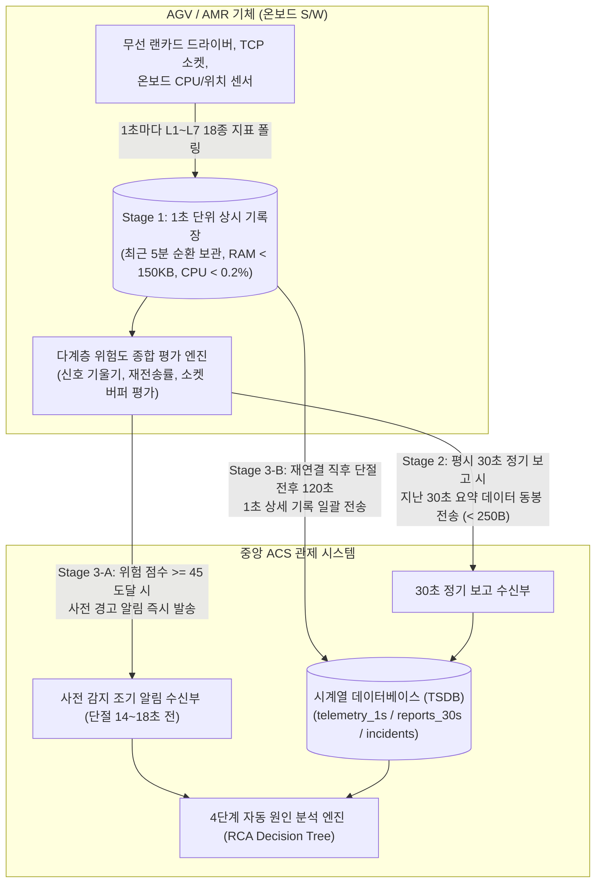
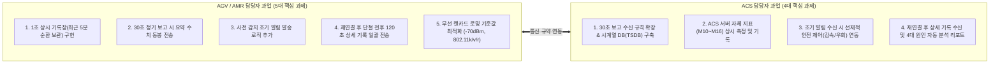

# 스마트 팩토리 AGV/AMR 무선 네트워크 상태 관제 & 사전 감지 대시보드

[](https://ghcr.io/planner77/network_dashboard)
[](https://python.org)
[](https://fastapi.tiangolo.com)
[](#)

스마트 제조 및 물류 현장에서 운용되는 **AGV(무인반송차) 및 AMR(자율이동로봇)**이 상위 제어 시스템인 **ACS(AGV/AMR Control System)**와 통신할 때 발생하는 **무선 단절(통신 끊김) 현상을 조기에 사전 감지(Pre-detection)**하고, 단절 발생 시 **양단(AGV/AMR 및 ACS) 수집 지표 기반 사후 원인 분석(Post-mortem RCA)**을 수행하는 실시간 시계열 관제 및 인터랙티브 모의 진단 플랫폼입니다.

별도의 무선 인프라(AP/WLC) 장비 접근 권한 없이도 **오직 AGV/AMR과 ACS 양단에서 직접 수집 가능한 21종 네트워크/시스템 상태 항목(MIMO 안테나별 신호 세기·편차, 무선 채널 정보, 링크 품질 지수 포함)**을 체계화하고, 일반 사용자도 쉽게 이해할 수 있는 평이한 용어와 **고시인성 인터랙티브 투어 가이드**를 제공합니다.

---

## 1. 핵심 배경 및 용어 해설

### 1.1 왜 기존 '30초 주기 상태 보고'만으로는 부족한가요?
- **현장 통신 구조**: AGV/AMR은 공장 천장에 설치된 Wi-Fi AP 및 공장 유선망을 거쳐 중앙 ACS 서버와 TCP 소켓 세션을 유지하며, **30초 주기로 상태 보고(Heartbeat)**를 전송합니다.
- **3~15초의 단절 순간**: AGV가 이동하며 무선 기지국(AP)을 갈아타거나 철제 랙 뒤쪽(음영 구역)에 진입할 때 무선 신호 급감 및 통신 단절은 **불과 수 초(3~15초) 내에 급격히 진행**됩니다.
- **사전 감지 불가 (나이퀴스트 샘플링 한계)**: 상위 보고 주기가 30초로 너무 길어 단절 직전까지 ACS는 AGV를 정상 상태로 오판합니다.
- **사후 원인 분석 불가 (블랙박스 부재)**: 소켓이 끊긴 뒤에는 현장 상태가 전송되지 않으므로 엔지니어는 단절 당시 전파 상태를 알 수 없어 단순 "무선 불량"으로 치부하는 악순환이 발생합니다.

### 1.2 일반 사용자를 위한 쉬운 핵심 개념 4가지
1. **AGV 내부 1초 단위 상시 기록장 *(개발 용어: 1초 고주파 링버퍼 / Ring Buffer)***
   - 차량의 **블랙박스**와 같습니다. AGV 컴퓨터 메모리에 작은 임시 기록장을 두고 1초마다 무선 신호 세기, 응답 지연 등을 빠짐없이 기록합니다.
   - **부하 제로**: 최근 5분(300초) 분량만 유지하고 가장 오래된 기록 위에 새 기록을 덮어쓰므로(순환 보관) 메모리(약 150KB 미만)나 CPU에 부담을 주지 않습니다.
2. **30초 정기 보고 시 요약 데이터 동봉 전송 *(개발 용어: 피기백 / Piggyback)***
   - 별도 통신 연결을 열지 않고, 기존 30초 상태 보고 메시지 끝에 **'지난 30초간의 통신 품질 요약표(최저 신호 세기, 평균 응답 시간, 재전송 횟수 등)'**를 덧붙여 함께 보냅니다.
   - 통신 횟수를 늘리지 않고도 ACS가 플릿 전체의 무선 건전성을 모니터링할 수 있습니다.
3. **실제 운영 시 시계열 데이터베이스(TSDB) 도입의 필요성**
   - 일반 RDB는 최신 상태 하나를 관리하는 데 적합하나, 무선 끊김 감지와 분석을 위해서는 **"시간 흐름(1초, 30초)에 따른 신호 세기·지연의 변화 추세(기울기)"**를 빠르게 저장·조회해야 합니다.
   - 따라서 실제 운영 환경에서는 대용량 시간순 데이터 압축 저장과 수명 관리(Retention)에 특화된 **시계열 데이터베이스(Time-Series DB)** 도입이 필수적입니다.
4. **장애 상황 가상 체험 *(개발 용어: Fault Injection)***
   - 실제 현장 통신을 끊지 않고도, 대시보드에서 4대 대표 장애 상황(로밍 실패, 음영 구역 진입, 채널 혼잡, 통신 프로그램 지연)을 가상으로 시뮬레이션하여 사전 감지 및 사후 분석 과정을 직접 검증할 수 있습니다.

---

## 2. 3단계 하이브리드 수집 아키텍처



- **Stage 1 (1초 상시 기록)**: AGV 내부에서 1초마다 상태를 측정하여 5분간 임시 보관 (평시 네트워크 전송 없음).
- **Stage 2 (30초 동봉 전송)**: 평시 30초 정기 보고에 30초간의 통계 요약값을 함께 동봉 전송 (대당 66 bps 미만).
- **Stage 3 (조기 알림 & 상세 일괄 전송)**: 위험 징후 포착 시 단절 14~18초 전 조기 경고를 즉시 발송하고, 재연결 후 단절 전후 120초의 1초 상세 기록을 일괄 전송하여 자동 원인 분석 수행.

---

## 3. AGV/AMR 및 ACS 수집 전용 지표 체계 (21종)

> **수집 위치 한정 원칙**: 현장 AP나 무선 컨트롤러(WLC) 관리 권한 없이도, **오직 AGV/AMR 단말과 ACS 서버 두 곳에서만 100% 직접 수집할 수 있는 항목**으로 구성되었습니다.

| ID | 계층 | 지표명 (한국어 / 영문) | 단위 | 수집 위치 | 권장 주기 | 시스템 부하 | 문제 발생 상황 · 사전 감지 · 사후 분석 활용법 |
| :---: | :---: | :--- | :---: | :---: | :---: | :---: | :--- |
| **M01** | L1 | 수신 신호 세기 (`RSSI`) | dBm | **AGV/AMR** | 로컬 1s / 보고 30s | 매우 낮음 | 음영 구역 진입 시 신호 급락 속도로 단절 15~18초 전 감지 |
| **M02** | L1 | 신호 대 잡음비 (`SNR`) | dB | **AGV/AMR** | 로컬 1s / 보고 30s | 매우 낮음 | 신호 세기는 강한데 통신이 끊어지는 설비 전파 간섭 규명 |
| **M03** | L1 | 전파 바닥 잡음 (`Noise Floor`) | dBm | **AGV/AMR** | 로컬 5s / 보고 30s | 낮음 | 용접기/고주파 설비 주변 외부 전자기파(EMI) 간섭 판별 |
| **M04** | L2 | 무선 연결 속도 및 변조 등급 (`PHY Rate & MCS Index`) | Mbps | **AGV/AMR** | 로컬 1s / 보고 30s | 매우 낮음 | 단절 직전 랜카드가 MCS 등급과 전송 속도를 낮추는 징후 포착 |
| **M05** | L2 | 무선 송수신 재시도율 (`Tx/Rx Retry Rate`) | % | **AGV/AMR** | 로컬 1s / 보고 30s | 낮음 | 소켓이 끊어지기 전 가장 먼저 치솟는 핵심 사전 위험 신호 |
| **M06** | L2 | 기지국 확인 신호 놓침 (`Beacon Loss`)| 회/초 | **AGV/AMR** | 로컬 1s / 보고 30s | 매우 낮음 | 연속 신호 누락을 통해 수 초 내 링크 두절 예고 |
| **M07** | L2 | 기지국 변경 소요 시간 (`Roaming Time`)| ms | **AGV/AMR** | 이벤트 즉시 | 매우 낮음 | 기존 AP를 놓지 못하는 지연 현상(Sticky Client) 진단 |
| **M08** | L2 | 무선 채널 혼잡도 (`Channel Busy Ratio`)| % | **AGV/AMR** | 로컬 5s / 보고 30s | 낮음 | 신호는 좋은데 끊어질 때 AP 동시 접속 과부하 증명 |
| **M09** | L3 | 관문 Ping 지연 및 손실률 (`Ping Latency & Packet Loss`)| ms / % | **AGV/AMR** | 로컬 2s / 보고 30s | 낮음 | 지연이 무선 구간 문제인지 유선 백본망 문제인지 분리 |
| **M10** | L3 | 응답 시간 흔들림 (`RTT Jitter`) | ms | **AGV/AMR, ACS** | 로컬 2s / 보고 30s | 매우 낮음 | 평균 지연이 정상이어도 편차가 커지는 불안정성 조기 포착 |
| **M11** | L4 | 소켓(TCP) 재전송 횟수 (`TCP Retrans`)| 회/초 | **AGV/AMR, ACS** | 로컬 1s / 보고 30s | 매우 낮음 | 상위 소켓 전송 실패 및 잠시 후 발생할 단절 예고 |
| **M12** | L4 | 소켓 종단 간 왕복 시간 (`TCP Smoothed RTT`)| ms | **AGV/AMR, ACS** | 로컬 1s / 보고 30s | 매우 낮음 | 실제 제어/보고 소켓이 겪는 지연 시간을 양단에서 측정 |
| **M13** | L4 | 소켓 송신 대기열 (`Send Queue / Send-Q`)| Bytes | **AGV/AMR, ACS** | 로컬 1s / 보고 30s | 매우 낮음 | 전송 버퍼가 비워지지 않고 쌓이는 통신 불능 상태 사전 감지 |
| **M14** | L4 | 소켓 수신 대기열 (`Recv Queue / Recv-Q`)| Bytes | **AGV/AMR, ACS** | 로컬 1s / 보고 30s | 매우 낮음 | 와이파이는 정상인데 통신 프로그램 응답 지연 발생 가려냄 |
| **M15** | L7 | 30초 보고 도착 간격 및 타임아웃 (`Heartbeat Timeout`)| sec | **ACS** | 매 보고 수신 시 | 매우 낮음 | 보고 간격이 30초→33초→37초로 밀리는 지연 AGV 식별 |
| **M16** | L7 | 소켓 연결 상태 및 재연결 (`TCP Socket State`)| State / 회 | **AGV/AMR, ACS** | 이벤트 발생 시 | 매우 낮음 | 시간 초과 단절인지 프로그램 강제 종료인지 원인 구분 |
| **M17** | SYS| AGV 온보드 CPU 사용률 (`AGV CPU Load`)| % | **AGV/AMR** | 로컬 5s / 보고 30s | 매우 낮음 | 자율주행(라이다/SLAM) 연산 폭주로 인한 통신 멈춤 판별 |
| **M18** | SYS| AGV 주행 위치 좌표 (`Pose X,Y & Speed`)| m, m/s | **AGV/AMR, ACS** | 로컬 1s / 보고 30s | 없음 | 공장 2D 지도 상의 상습 무선 음영 구역 히트맵 매핑 |
| **M19** | L1 | **MIMO 안테나별 신호 세기 및 편차** (`Per-Antenna RSSI & Imbalance`) | dBm / dB | **AGV/AMR** | 로컬 1s / 보고 30s | 매우 낮음 | **안테나 한쪽 단선/커넥터 풀림 또는 회전 시 차체 가림**(편차 ≥10dB) 사전 감지 및 하드웨어 결함 판별 |
| **M20** | L1 | **무선 주파수 대역·채널 번호 및 대역폭** (`Wi-Fi Band, Channel & Width`) | GHz/Ch/MHz | **AGV/AMR** | 로컬 1s / 보고 30s | 매우 낮음 | **2.4GHz 저속 대역 강등(Band Steering 실패) 즉시 감지** 및 특정 채널 번호 단말 편중(동일 채널 간섭) 규명 |
| **M21** | L1 | **무선 링크 종합 품질 지수** (`Wi-Fi Link Quality`) | % (점/70) | **AGV/AMR** | 로컬 1s / 보고 30s | 매우 낮음 | **철제 구조물 다중 경로 난반사(Multipath)**로 신호 세기는 높은데 파형이 깨지는 품질 저하 직관적 감지·분석 |

> 상세 메타데이터 및 Linux/C 명령어 예시는 [docs/ANALYSIS_AND_METRICS.md](file:///home/planner/Dev/network_dashboard/docs/ANALYSIS_AND_METRICS.md)를 참조하십시오.

---

## 4. AGV 담당자와 ACS 담당자 업무 분담

현장 적용을 위해 **AGV/AMR 담당자**와 **ACS 담당자**가 각각 구현해야 할 과업입니다.



---

## 5. 4대 장애 시나리오 및 자동 근본 원인 분석 (RCA)

대시보드에서 실시간 가상 체험(시뮬레이션) 및 타임라인 분석이 가능한 4대 대표 장애 시나리오입니다.


1. **SCN-01: AP 로밍 실패 (기지국 변경 지연 / Sticky Client)**
   - 신호가 약해졌는데도 기존 기지국을 놓지 못하다가 통신 단절 (단절 **18초 전** 사전 감지).
2. **SCN-02: 물리적 음영 구역 진입 및 설비 EMI 간섭**
   - 철골 랙 뒤편 급격한 신호 감쇠(-85dBm 이하) 또는 용접 구역의 노이즈 폭등 (단절 **16초 전** 사전 감지).
3. **SCN-03: AP 채널 과부하 및 동일 채널 혼잡 (Co-Channel Congestion)**
   - 물류 밀집 구역에서 신호는 정상이나 채널 점유율 80% 초과로 통신 정체 (단절 **15초 전** 사전 감지).
4. **SCN-04: 통신 프로그램 일시 멈춤 / 응답 지연 (AGV 온보드 CPU 병목)**
   - 와이파이 신호는 완벽하나 AGV CPU 98% 과부하로 송신 대기열이 가득 참 (단절 **14초 전** 사전 감지).

---

## 6. `.env` 환경 설정 명세

모든 운영 설정값은 프로젝트 루트의 `.env` 파일에서 관리되며, `docker-compose.yml` 및 백엔드가 이를 자동으로 로드합니다.

| 환경변수 키 | 기본값 | 설명 |
| :--- | :---: | :--- |
| `HOST` | `0.0.0.0` | 백엔드 웹 서버 바인딩 호스트 주소 |
| `PORT` | `9921` | 컨테이너 내부 및 로컬 서버 실행 포트 |
| `DASHBOARD_PORT` | `9921` | 외부 호스트에서 접속하는 웹 대시보드 포트 (`http://localhost:9921`) |
| `DEFAULT_THEME` | `light` | 웹 화면 기본 컬러 테마 (`light` 또는 `dark`) |
| `AGV_COUNT` | `6` | 시뮬레이션 대상 AGV 대수 (`AGV-01` ~ `AGV-06`) |
| `ACS_REPORT_INTERVAL_SEC` | `30` | AGV → ACS 정기 상태 보고 주기 (초) |
| `LOCAL_RECORD_INTERVAL_SEC` | `1` | AGV 내부 임시 기록장 상태 측정 주기 (초) |
| `LOCAL_BUFFER_RETENTION_SEC` | `300` | AGV 내부 임시 기록장 보관 시간 (최근 5분 = 300초) |
| `TSDB_PATH` | `/app/tsdb_data/network_telemetry.db` | 시계열 데이터 저장 파일 경로 |
| `TSDB_RETENTION_SEC` | `3600` | 시계열 데이터 실시간 보관 창 (초) |
| `TSDB_SEED_HISTORY_SEC` | `600` | 초기 기동 시 생성하는 과거 이력 데이터 시간 (초) |

---

## 7. 빠른 시작 가이드 (Quickstart)

### 방법 1: Docker Compose 실행 (가장 권장)
```bash
# 1. 저장소 루트에서 백그라운드 구동 (.env 자동 적용, 포트 9921)
docker compose up -d

# 2. 브라우저에서 접속
http://localhost:9921
```
서비스 중지는 `docker compose down`으로 수행합니다.

---

### 방법 2: GitHub Container Registry (GHCR) 원클릭 실행
```bash
docker run -d \
  --name network-dashboard \
  -p 9921:9921 \
  -v tsdb_data:/app/tsdb_data \
  --restart unless-stopped \
  ghcr.io/planner77/network_dashboard:latest
```

---

### 방법 3: 로컬 Python 가상환경 개발 실행
```bash
# 1. 가상환경 생성 및 활성화
python3 -m venv .venv
source .venv/bin/activate

# 2. 의존성 패키지 설치
pip install -r requirements.txt

# 3. 9921 포트로 서버 실행
uvicorn app.main:app --host 0.0.0.0 --port 9921 --reload
```

---

## 8. 자동화 테스트 실행

```bash
# 포트 9921, 라이트 기본 테마, 18종 수집 위치, 5대 탭 통합 검증
pytest tests/test_api.py -v
```

---

## 9. 웹 대시보드 화면 구성 (5대 핵심 탭 + 고시인성 투어)

상단 **`[가이드 투어 (7단계)]`** 버튼을 클릭하면 발표용 인터랙티브 가이드가 동작합니다.

1. **Tab 1: `1. 실시간 관제 & 2D 맵`**
   - 상단 4열 요약 카드 (운행 AGV 연결 상태, 30초 보고 성공률, 사전 감지 조기 알림 시간, 시계열 데이터 수집 현황).
   - 스마트 팩토리 2D Floor Plan & 전파 음영/간섭 구역 히트맵 (AP 4기 위치, AGV 6대 실시간 주행).
   - AGV 상태 테이블 및 **장애 상황 가상 체험(시뮬레이션 실행)** 컨트롤러.
2. **Tab 2: `2. 사전 감지 & 사후 원인 분석`**
   - 4대 장애 상황 선택 카드 및 타임라인 재생기 (T-18초 사전 감지 vs T=0초 30초 보고 단절 비교).
   - 3단 동기화 시계열 차트 및 4단계 자동 원인 분석 표.
3. **Tab 3: `3. 수집 항목 백과사전 (21종)`**
   - **AGV/AMR 및 ACS 수집 지표(21종 — MIMO 안테나별 신호·채널 정보·링크 품질 포함)** 수록 (위치 필터: 전체, AGV/AMR, ACS).
   - 상단 컬럼명이 항상 고정되는 **고정 헤더(Sticky Header) 일람표** 및 항목별 **의미 · 문제 발생 상황 · 사전 감지 방법 · 사후 분석 방법** 심층 설명 카드.
4. **Tab 4: `4. 단계별 수집 구조 & 시계열 DB 필요성`**
   - 3단계 하이브리드 수집 방식 설명, 시계열 데이터베이스(TSDB) 도입 필요성, 30초 동봉 패킷 인스펙터 및 플릿 네트워크 부하 계산기.
5. **Tab 5: `5. 담당자별 해야 할 일 (AGV & ACS)`**
   - **AGV/AMR 담당자** 5대 과제·수집 항목·체크리스트, **ACS 담당자** 4대 과제·시계열 DB 구축·체크리스트, AGV↔ACS 데이터 전송 규격 요약표.

---

## 10. 변경 사항 (Changelog)

### v1.1.3 (2026-11-16)
- **MIMO 안테나별 신호 세기, 채널 상세 정보, 무선 링크 종합 품질 독립 항목(`M19`~`M21`) 추가 (18종 → 21종 확장)**:
  - **`M19` MIMO 안테나별 신호 세기 및 편차 (`Per-Antenna RSSI & Chain Imbalance`)**: 2×2 MIMO 안테나의 개별 신호(`Chain 0`, `Chain 1`) 및 안테나 간 편차(dB)를 수집하여 합산 RSSI(`M01`)만으로는 절대 알 수 없는 **한쪽 안테나 커넥터 풀림/단선 및 회전 시 차체 철판 가림**을 사전 감지·사후 규명.
  - **`M20` 무선 주파수 대역·채널 번호 및 대역폭 (`Wi-Fi Band, Channel & Width`)**: 주파수 대역(`2.4GHz`/`5GHz`), 채널 번호(`Ch.36` 등), 대역폭(`20/40/80MHz`)을 수집하여 **2.4GHz 저속 대역 강등(Band Steering 실패) 즉시 감지** 및 특정 채널 단말 편중 분석.
  - **`M21` 무선 링크 종합 품질 지수 (`Wi-Fi Link Quality`)**: `/proc/net/wireless`의 `link(0~70)` 점수를 백분율(`0~100%`)로 환산하여 **철제 랙 다중 경로 난반사(Multipath Fading)**로 인한 전파 파형 왜곡을 직관적으로 감지·판별.
- **전 항목(21종) 상세 설명에 4대 핵심 분석 구조(`의미 · 문제 발생 상황 · 사전 감지 방법 · 사후 분석 방법`) 명시**:
  - 백과사전 탭 우측 상세 인스펙터와 하단 전체 카드 목록에 **`[문제가 발생할 수 있는 현장 상황]`**, **`[문제 발생 전 사전 감지 방법]`**, **`[문제 발생 후 사후 분석 방법]`**을 구분 표시하여 현업 활용성 강화.

### v1.1.2 (2026-11-15)
- **GitHub 저장소 Packages 섹션 GHCR 자동 연결**:
  - `Dockerfile`에 OCI 표준 레이블(`org.opencontainers.image.source="https://github.com/planner77/network_dashboard"`)을 추가하여 GHCR 이미지가 GitHub 저장소 우측 **Packages** 섹션에 자동 연결·표시되도록 조치.
- **GHCR 도커 이미지 내 Mock-up 시계열 DB 사전 적재(Pre-seed) 및 실시간 생성 이중 보장**:
  - 도커 이미지 빌드 단계에서 `/app/tsdb_data/network_telemetry.db`에 초기 Mock-up 데이터(AGV 6대 × 600초 1초 단위 이력 3,600건, 30초 정기 보고 120건, 4대 장애 시나리오 사건 기록 4건, 18종 수집 지표 카탈로그)를 물리적으로 내장하고, 컨테이너 실행 시 현재 시각 기준으로 최신화 및 1초 단위 실시간 생성을 수행하도록 강화.

### v1.1.1 (2026-11-15)
- **투어 가이드 툴팁 상자 드래그 이동 기능 추가**:
  - 투어 설명 카드(`#tour-popover`)의 상단 헤더 바(`#tour-popover-header`, `✥ 이동` 핸들)를 마우스 또는 터치로 잡고 화면 원하는 위치로 자유롭게 이동 가능(더블클릭 시 우측 하단 기본 위치로 복귀).
- **7대 핵심 네트워크 항목 매핑 명시 강화**:
  - `MCS Index` (`M04`), `Tx/Rx Retry Rate` (`M05`), `Ping Latency` & `Packet Loss` (`M09`), `Send/Recv Queue` (`M13`, `M14`), `Heartbeat Timeout` (`M15`), `TCP Socket State` (`M16`) 명칭 및 수집 방법을 백과사전과 명세서에 명확히 병기하여 즉시 검색·확인 가능하도록 보완.

### v1.1.0 (2026-11-15)
- **포트 9921 전환 및 `.env` 통합**:
  - 기본 접속 포트를 `9921`(`PORT=9921`, `DASHBOARD_PORT=9921`)로 표준화하고 `docker-compose.yml`에 `env_file: - .env` 연동.
- **Light Enterprise 기본 테마 및 2단 헤더 개편**:
  - 고가독성 `Light Enterprise` 테마를 기본값으로 적용(`DEFAULT_THEME=light`).
  - 상단 헤더를 2단 구조(`navbar-top`: 브랜드/상태/도구, `navbar-tabs-bar`: 5대 탭)로 분리하여 `'실시간 수집 중'` 배지와 메뉴 탭 간의 겹침 현상 원천 차단.
- **고시인성 인터랙티브 투어 가이드 포커스 강화**:
  - 스텝 이동 시 즉시 스크롤(`instant`) 및 대상 요소 직접 하이라이트 클래스(`tour-active-target`), 고대비 포커스 프레임 및 설명 영역 배지(`📍 현재 설명 영역`) 추가.
- **수집 위치 범위의 엄격한 한정 (AGV/AMR 및 ACS 양단 전용)**:
  - 현장 AP/WLC 장비 접근 권한이 없는 환경을 고려하여 18종 모든 지표의 수집 위치를 **오직 AGV/AMR 단말과 ACS 서버**로만 엄격히 한정하고 AP 전용 명령어 배제.
- **일반 사용자를 위한 쉬운 한국어 용어 전면 개편**:
  - `피기백` → **30초 정기 보고 시 요약 데이터 동봉 전송**
  - `1초 고주파 링버퍼` → **AGV 내부 1초 단위 상시 기록장 (최근 5분 순환 보관)**
  - `시나리오 주입` → **장애 상황 가상 체험 (시뮬레이션 실행)**
  - `내장 시계열 DB` → **실제 운영 시 시계열 데이터베이스(TSDB) 도입 필요성**
  - `소켓 행` → **통신 프로그램 일시 멈춤 (응답 지연)**
- **Tab 5 신설 (`담당자별 해야 할 일: AGV & ACS`)**:
  - AGV 담당자(5대 과업) 및 ACS 담당자(4대 과업)별 상세 개발 지침, 체크리스트, 데이터 전송 규격 제공.
- **수집 항목 일람표 상단 헤더 고정 (Sticky Header)**:
  - Tab 3 테이블에 `position: sticky; top: 0` 고정 헤더 적용으로 스크롤 중에도 컬럼 제목 상시 확인 가능.

### v1.0.0 (2026-11-15)
- 최초 버전 릴리스 (단일 All-in-One 이미지, 18종 수집 항목, 4대 장애 시나리오 시뮬레이터, 다크/라이트 테마).

---

## 11. 핵심 프로젝트 문서 링크 (Routing Guide)

- [AGENTS.md](file:///home/planner/Dev/network_dashboard/AGENTS.md): 프로젝트 운영 원칙, 7단계 개발 파이프라인, 에이전트 업무 분장 및 보안 수칙.
- [DESIGN.md](file:///home/planner/Dev/network_dashboard/DESIGN.md): 전문가 관제 시스템 Light Enterprise 테마, 타이포그래피, 2단 헤더, Sticky 헤더, 투어 가이드 표준.
- [ANALYSIS_AND_METRICS.md](file:///home/planner/Dev/network_dashboard/docs/ANALYSIS_AND_METRICS.md): AGV/ACS 전용 18종 수집 지표 명세, 쉬운 용어 정의, 4대 장애 시나리오 RCA 의사결정 알고리즘, AGV/ACS 담당자별 과업.
- [ARCHITECTURE.md](file:///home/planner/Dev/network_dashboard/docs/ARCHITECTURE.md): 시스템/DB 스키마(TSDB 필요성), `.env` 환경변수(포트 9921), REST API 명세, 5대 탭 구조.
- [FAILURE_LEDGER.md](file:///home/planner/Dev/network_dashboard/docs/FAILURE_LEDGER.md): 빌드/런타임 실패 및 설계 개선 이력 투명 기록 원장.
