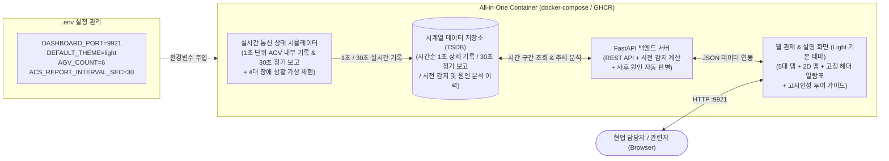

# 시스템 아키텍처 및 기술 설계서 (ARCHITECTURE.md)

> **참조 안내**: 본 문서는 시계열 데이터베이스(TSDB) 도입 구조, `.env` 기반 환경 설정(포트 `9921`), 백엔드 API 명세, 5대 핵심 화면 구성 및 `docker-compose.yml` 배포 설계를 정의합니다.

---

## 1. 전체 시스템 아키텍처 및 시계열 DB(TSDB)의 필요성

### 왜 실제 운영 환경에서 시계열 데이터베이스(TSDB)가 필요한가?
1. **시간 흐름에 따른 변화 추세(기울기) 계산**: 무선 신호(RSSI)가 현재 `-70dBm`이라는 단편적 값보다 **"최근 10초 동안 초당 `-2.5dBm`씩 급락하고 있다"**는 시간별 추세가 사전 감지의 핵심입니다.
2. **대용량 시간순 데이터의 고속 저장 및 자동 수명 관리(Retention)**: 여러 대의 AGV가 보내오는 30초 요약 데이터와 장애 전후 1초 단위 상세 기록을 시간 인덱스로 빠르게 저장하고, 일정 기간(예: 30일~90일)이 지난 오래된 데이터는 자동으로 압축·정리하기 위해 시계열 DB 도입이 필수적입니다.

---

## 2. `.env` 기반 환경 설정 항목

모든 주요 운영 설정은 프로젝트 루트의 `.env` 파일에서 관리하며, `docker-compose.yml`과 백엔드 애플리케이션이 이를 자동으로 읽어 구동됩니다.

| 환경변수 키 | 기본값 | 설명 |
| :--- | :--- | :--- |
| `HOST` | `0.0.0.0` | 백엔드 웹 서버 바인딩 호스트 주소 |
| `PORT` | `9921` | 컨테이너 내부 및 로컬 서버 실행 포트 |
| `DASHBOARD_PORT` | `9921` | 외부 호스트에서 접속하는 웹 대시보드 포트 (`http://localhost:9921`) |
| `DEFAULT_THEME` | `light` | 웹 화면 기본 컬러 테마 (`light` 또는 `dark`) |
| `AGV_COUNT` | `6` | 시뮬레이션 대상 AGV/AMR 대수 (`AGV-01` ~ `AGV-06`) |
| `ACS_REPORT_INTERVAL_SEC` | `30` | AGV → ACS 정기 상태 보고 주기 (초) |
| `LOCAL_RECORD_INTERVAL_SEC` | `1` | AGV 내부 임시 기록장 상태 측정 주기 (초) |
| `LOCAL_BUFFER_RETENTION_SEC` | `300` | AGV 내부 임시 기록장 보관 시간 (최근 5분 = 300초) |
| `TSDB_PATH` | `/app/tsdb_data/network_telemetry.db` | 시계열 데이터 저장 파일 경로 |
| `TSDB_RETENTION_SEC` | `3600` | 실시간 시계열 데이터 보관 시간 창 (초) |
| `TSDB_SEED_HISTORY_SEC` | `600` | 초기 기동 시 즉시 차트 확인을 위해 생성하는 과거 이력 시간 (초) |

---

## 3. REST API 엔드포인트 명세

| 메서드 & 경로 | 설명 |
| :--- | :--- |
| `GET /api/health` | 서버 상태, 적용된 `.env` 설정 요약(`port`, `default_theme` 등), 시계열 데이터 적재 현황 반환 |
| `GET /api/config` | `.env`에서 로드된 프론트엔드/운영 설정값(`port`, `default_theme`, `agv_count`, `report_interval_sec` 등) 반환 |
| `GET /api/overview` | 전체 AGV 6대 실시간 상태, 4대 핵심 요약 지표(KPI), 구역별 무선 상태, 최근 30초 정기 보고 및 사전 감지 이력 반환 |
| `GET /api/agv/{agv_id}/timeseries?window_sec=180` | 특정 AGV의 최근 N초간 1초 단위 시계열 데이터 및 30초 정기 보고 시점 마커 반환 |
| `GET /api/scenarios` | 4대 장애 시나리오(`SCN-01`~`SCN-04`)의 120초 상세 파형 및 4단계 사후 원인 판별 결과 반환 |
| `POST /api/scenarios/trigger` | 선택한 AGV에 특정 장애 시나리오를 가상 체험(시뮬레이션 실행)하도록 시작 |
| `POST /api/scenarios/reset` | 모든 AGV의 장애 가상 체험 상태를 해제하고 정상 운행 상태로 복귀 |
| `GET /api/metrics-catalog` | **AGV/AMR 및 ACS 전용 21종 수집 항목(MIMO 안테나별 신호·채널 정보·링크 품질 포함)** 전체 명세 반환 |
| `GET /api/hybrid-architecture` | 3단계 수집 구조, 시계열 DB 도입 필요성, **AGV 담당자 및 ACS 담당자 역할 분담(`role_action_plans`)** 반환 |
| `GET /api/incidents` | 사전 감지 및 단절 사건 이력과 사후 원인 분석 리포트 목록 반환 |

---

## 4. 프론트엔드 화면 구성 (5대 핵심 탭 + 고시인성 투어 가이드)

1. **Tab 1: `1. 실시간 관제 & 2D 맵`**
   - 상단 4열 요약 카드(운행 AGV 연결 상태, 30초 정기 보고 성공률, 사전 감지 조기 알림 시간, 시계열 데이터 수집 현황).
   - 좌측: 2D 스마트 팩토리 맵 & 전파 음영/간섭 구역 히트맵.
   - 우측: **장애 상황 가상 체험(시뮬레이션 실행)** 컨트롤러, AGV 실시간 상태 표, 선택 AGV의 1초 시계열 추이 차트.
2. **Tab 2: `2. 사전 감지 & 사후 원인 분석`**
   - 4대 장애 상황 선택 카드 및 타임라인 재생기(`T-18초 사전 감지 시점` vs `T=0초 30초 보고 끊김 시점` 비교).
   - 3단 동기화 시계열 차트(무선 신호 계층 / 소켓 전송 계층 / 종합 위험도 점수 및 30초 보고 시점) + 4단계 자동 원인 판별표.
3. **Tab 3: `3. 수집 항목 백과사전 (21종)`**
   - **AGV/AMR과 ACS에서 수집할 수 있는 21종 항목**만 수록 (수집 위치 필터: `전체`, `AGV/AMR`, `ACS`).
   - 스크롤 시에도 컬럼 제목이 항상 상단에 고정되는 **고정 헤더(Sticky Header) 일람표** 및 항목별 **의미 · 문제 발생 상황 · 사전 감지 방법 · 사후 분석 방법** 상세 설명 카드.
4. **Tab 4: `4. 단계별 수집 방식 & 시계열 DB 필요성`**
   - 쉬운 용어로 풀어쓴 3단계 하이브리드 수집 방식(① AGV 1초 내부 기록장 → ② 30초 보고 시 요약 동봉 → ③ 조기 경보 & 재연결 후 상세 기록 전송), 시계열 DB(TSDB) 도입 필요성, 전송 데이터 구조 및 통신 부하 계산기.
5. **Tab 5: `5. 담당자별 해야 할 일 (AGV & ACS)`**
   - **AGV/AMR 담당자**가 해야 할 5대 핵심 과업·수집 지표·체크리스트와 **ACS 담당자**가 해야 할 4대 핵심 과업·시계열 DB 구축·관제 제어 연동 체크리스트, 그리고 양측 간 주고받을 데이터 규격 요약.
