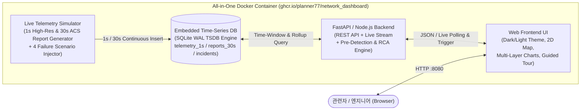

# 시스템 아키텍처 및 기술 설계서 (ARCHITECTURE.md)

> **참조 안내**: 본 문서는 백엔드 시계열 DB(TSDB), 실시간 시뮬레이션 엔진, API 명세, 프론트엔드 모듈 구조 및 All-in-One Docker/GHCR 배포 설계를 정의합니다.

---

## 1. 전체 시스템 아키텍처 개요

사용자 선택사항(**A1: 단일 All-in-One 도커 이미지**, **A2: 하이브리드 수집 모델**, **A3: 4대 장애 시나리오 + 2D 맵 히트맵 + 사전 감지 타임라인 시뮬레이션**, **A4: 다크/라이트 테마 지원**)을 반영한 통합 아키텍처입니다.



---

## 2. 시계열 데이터베이스(TSDB) 스키마 설계

외부 DB 컨테이너 의존성 없이 `docker run` 한 번으로 즉시 동작하면서도 실제 시계열 쿼리(시간 범위 조회, 이동평균, 다운샘플링, 최신 상태 집계)를 고속 처리하기 위해 **SQLite3 WAL(Write-Ahead Logging) 기반 시계열 스키마**를 내장합니다.

### 2.1 핵심 시계열 테이블
1. **`telemetry_1s` (1초 주기 고해상도 시계열 테이블 — AGV 로컬 링버퍼 & 블랙박스 덤프 모사)**
   - `ts` (`INTEGER`, Unix epoch ms, Descending Index)
   - `agv_id` (`TEXT`, 예: `AGV-01` ~ `AGV-06`)
   - `zone_id` (`TEXT`, `ZONE-A` ~ `ZONE-D`), `bssid` (`TEXT`, 연결된 AP MAC)
   - `pos_x` (`REAL`), `pos_y` (`REAL`), `velocity` (`REAL`)
   - **L1/L2 지표**: `rssi` (`REAL`), `snr` (`REAL`), `noise_floor` (`REAL`), `phy_rate` (`REAL`), `l2_retry_rate` (`REAL`), `beacon_loss` (`INTEGER`), `roaming_ms` (`REAL`), `channel_util` (`REAL`)
   - **L3/L4 지표**: `gw_rtt_ms` (`REAL`), `jitter_ms` (`REAL`), `tcp_retrans` (`INTEGER`), `tcp_srtt_ms` (`REAL`), `send_q_bytes` (`INTEGER`), `recv_q_bytes` (`INTEGER`)
   - **L7/System 지표**: `cpu_load` (`REAL`), `softirq_pct` (`REAL`), `hb_delta_sec` (`REAL`)
   - **분석 지표**: `risk_score` (`REAL`, 0~100), `conn_state` (`TEXT`: `CONNECTED`, `PRE_WARNING`, `DISCONNECTED`), `scenario_code` (`TEXT`: `NORMAL`, `SCN-01`, `SCN-02`, `SCN-03`, `SCN-04`)
   - **복합 인덱스**: ` idx_telemetry_agv_ts ON telemetry_1s(agv_id, ts DESC)`

2. **`acs_reports_30s` (30초 주기 ACS 소켓 상태 보고 + 하이브리드 요약 피기백 테이블)**
   - `report_id` (`INTEGER PRIMARY KEY AUTOINCREMENT`)
   - `ts` (`INTEGER`), `agv_id` (`TEXT`), `report_status` (`TEXT`: `OK`, `DELAYED`, `TIMEOUT_MISSED`)
   - `hb_interval_sec` (`REAL`)
   - `piggyback_summary_json` (`TEXT`: 지난 30초간 `rssi_min`, `rssi_avg`, `snr_min`, `l2_retry_max`, `tcp_retrans_sum`, `gw_rtt_max`, `roaming_count`, `max_risk_score`)

3. **`incident_events` (사전 감지 경보 및 사후 원인 분석 리포트 테이블)**
   - `incident_id` (`TEXT PRIMARY KEY`), `ts_detected` (`INTEGER`), `ts_disconnected` (`INTEGER`), `lead_time_sec` (`REAL`, 사전 감지 선행 시간)
   - `agv_id` (`TEXT`), `scenario_code` (`TEXT`), `title` (`TEXT`), `severity` (`TEXT`)
   - `root_cause_summary` (`TEXT`), `evidence_metrics_json` (`TEXT`), `recommended_action` (`TEXT`)

---

## 3. 백엔드 API 및 실시간 시뮬레이터 설계

- **프레임워크**: Python `FastAPI` + `uvicorn` (단일 프로세스 내 백그라운드 `asyncio` 태스크로 1초 주기 TSDB 실시간 시뮬레이터 가동 및 정적 프론트엔드 서빙).
- **초기 시드 데이터(Historical Seed)**:
  - 컨테이너 시작 시 과거 30분 분량의 시계열 데이터 및 4대 장애 시나리오(`SCN-01` ~ `SCN-04`)의 완벽한 고해상도 사건 기록(단절 전 60초 ~ 단절 후 60초, 1초 간격)을 TSDB에 즉시 적재하여 접속 즉시 풍부한 차트와 분석 결과를 확인할 수 있도록 구성.
- **실시간 스트리밍(Live Simulator)**:
  - 매 1초마다 6대 AGV(`AGV-01` ~ `AGV-06`)의 공장 내 이동 궤적과 18개 네트워크 지표를 계산하여 `telemetry_1s`에 INSERT하고, 매 30초마다 `acs_reports_30s` 레코드를 생성(오래된 데이터는 자동 Retention 정리).

### REST API 엔드포인트 명세
| 메서드 & 경로 | 설명 |
| :--- | :--- |
| `GET /api/health` | 서버 및 내장 TSDB 상태, 총 적재 시계열 포인트 수, 시뮬레이터 가동 상태 반환 |
| `GET /api/overview` | 전체 AGV 6대 실시간 상태 요약, KPI 지표(평균 RSSI, 활성 사전감지 경보 수, 30초 보고 성공률, TSDB 적재량), AP 4기 상태 및 구역별 히트맵 데이터 반환 |
| `GET /api/agv/{agv_id}/timeseries?window_sec=180` | 특정 AGV의 최근 N초간 1초 단위 시계열 데이터 및 30초 보고 마커 반환 |
| `GET /api/scenarios` | 4대 핵심 장애 시나리오(`SCN-01`~`SCN-04`) 목록, 사전 감지/사후 분석 시계열 데이터셋(120초 구간 1초 해상도), RCA 의사결정 트리 진단 결과 반환 |
| `POST /api/scenarios/trigger` | 선택한 AGV에 특정 장애 시나리오(`SCN-01`~`SCN-04`)를 실시간 주입하여 라이브 대시보드에서 즉시 사전 감지 → 단절 → 복구 과정을 재현 |
| `GET /api/metrics-catalog` | 18개 수집 항목 전체 명세(이름, 계층, 설명, 단위, 임계치, 수집 위치, 권장 주기, 부하 수준, 수집 명령어/코드 예시, 사전/사후 분석 활용법) 반환 |
| `GET /api/incidents` | 발생한 사전 감지 및 단절 이벤트 이력과 사후 원인 분석(RCA) 리포트 목록 반환 |

---

## 4. 프론트엔드 화면 구성 (4대 전문 뷰 + 인터랙티브 투어 가이드)

`DESIGN.md`를 준수하여 다음과 같이 4개의 핵심 탭과 스포트라이트 투어 가이드로 구성합니다.

1. **Tab 1: 실시간 통합 관제 & 2D 팩토리 맵 (`Live Fleet & 2D Floor Map`)**
   - **상단 KPI 4열 카드**: ① 연결 정상 AGV / 전체 대수, ② 30초 소켓 보고 성공률 & 평균 Heartbeat 간격, ③ 사전 감지 조기 경보(Pre-Detection Lead Time 평균 `16.4초`), ④ 내장 TSDB 실시간 수집 속도 및 총 레코드 수.
   - **중앙 좌측 (7 Columns)**: **인터랙티브 2D 스마트 팩토리 맵 & 무선 음영 히트맵** (AP 4기 위치, 전파 커버리지, 물리적 음영구역/EMI 간섭구역 표시, AGV 6대 실시간 주행 애니메이션 및 클릭 시 포커스).
   - **중앙 우측 (5 Columns)**: **AGV 플릿 상태 테이블 & 실시간 1초/30초 비교 스트림 미니 차트** + **[장애 시나리오 실시간 주입(Trigger)]** 컨트롤러.
2. **Tab 2: 사전 감지 & 사후 원인 분석 랩 (`Pre-Detection & Post-Mortem RCA Lab`)**
   - **시나리오 선택 바**: ① AP 로밍 실패(`SCN-01`), ② 물리적 음영/EMI 간섭(`SCN-02`), ③ AP 채널 과부하(`SCN-03`), ④ 소켓 행/시스템 병목(`SCN-04`).
   - **타임라인 재생/비교 컨트롤러**: 재생/일시정지 및 타임슬라이더를 통해 **`T-18s` 사전 감지 경보 시점(Amber Line)**과 **`T-0s` 30초 소켓 보고 단절 시점(Red Line)**을 직접 비교.
   - **3단 동기화 시계열 차트**:
     - Chart 1: `RSSI (dBm)` & `SNR (dB)` & `Channel Util (%)`
     - Chart 2: `Gateway RTT (ms)` & `TCP Retransmits` & `Socket Send-Q / Recv-Q`
     - Chart 3: `Pre-Detection Risk Score (0~100)` vs `30초 주기 ACS 상태 보고 시점 마커`
   - **우측 자동 원인 분석(Automated RCA) 패널**: 시그니처 매칭 과정(증거 지표 체크리스트), 근본 원인 판정 결과, 현장 조치 가이드 제시.
3. **Tab 3: 수집 항목 백과사전 (`Telemetry Metrics Encyclopedia`)**
   - 계층별(전체 / L1·L2 무선 / L3·L4 전송 / L7·시스템) 및 수집 위치별(AGV / AP·WLC / ACS) 필터 및 검색 기능.
   - 18개 지표 각각의 **항목명, 설명, 단위/임계치 바, 수집 위치 배지, 권장 주기, 시스템 부하 등급(게이지), 실제 Linux/C/Python 수집 명령어 예시, 사전 감지 및 사후 분석 활용법**을 정렬된 테이블 및 상세 드로어/카드로 제공.
4. **Tab 4: 하이브리드 수집 아키텍처 & 프로토콜 명세 (`Hybrid Architecture & Protocol`)**
   - 왜 기존 30초 소켓 보고만으로는 부족한지 비교 다이어그램 제시.
   - **Stage 1(1s 로컬 링버퍼) → Stage 2(30s 통계 피기백 JSON 패킷 구조) → Stage 3(조기 경보 & 블랙박스 덤프)** 데이터 흐름도 및 대역폭/부하 계산기 제공.
5. **인터랙티브 투어 가이드 (`Spotlight Tour Guide`)**
   - 최초 접속 시 또는 상단 `[가이드 투어 (7 Steps)]` 버튼 클릭 시, 배경 설명부터 각 탭의 핵심 기능까지 자동으로 탭을 넘기며 하이라이트 박스와 발표 스크립트를 제공하는 프레젠테이션 모드 지원.

---

## 5. 디렉토리 구조 및 도커 배포 설계

```text
/home/planner/Dev/network_dashboard/
├── AGENTS.md                     # 프로젝트 총괄 지침 및 문서 라우팅 (필수 참조)
├── DESIGN.md                     # UI/UX 디자인 시스템 및 정렬/테마 표준
├── README.md                     # 프로젝트 소개 및 실행/배포 가이드
├── Dockerfile                    # 단일 All-in-One 컨테이너 이미지 빌드 파일
├── docker-compose.yml            # 로컬/운영 즉시 실행용 Compose 설정
├── .dockerignore                 # .env, .git 등 제외 설정
├── .gitignore                    # .env, DB 파일, 캐시 제외 설정
├── docs/
│   ├── ANALYSIS_AND_METRICS.md   # 네트워크 수집 항목 18종 및 사전/사후 분석 명세
│   ├── ARCHITECTURE.md           # 시스템/DB/API 아키텍처 설계서
│   └── FAILURE_LEDGER.md         # 단계별 실패 원장 및 해결 기록
├── app/
│   ├── main.py                   # FastAPI 서버 엔트리포인트 및 정적 파일 라우팅
│   ├── tsdb.py                   # SQLite WAL 시계열 DB 엔진 및 쿼리 모듈
│   ├── simulator.py              # 실시간 AGV 6대 시뮬레이터 및 4대 시나리오 생성기
│   ├── metrics_catalog.py        # 18종 수집 지표 상세 메타데이터 및 분석 로직
│   └── static/
│       ├── index.html            # 메인 SPA 레이아웃 (다크/라이트 테마, 4대 탭, 투어 모달)
│       ├── css/
│       │   └── styles.css        # DESIGN.md 기반 정밀 그리드 및 테마 스타일시트
│       └── js/
│           └── app.js            # 실시간 차트, 2D 맵 히트맵, RCA 시뮬레이터, 투어 가이드 로직
└── tests/
    └── test_api.py               # 로컬 검증용 자동화 테스트 스크립트
```
